# AWS Cloud Security: Delegated IAM Administrator & MFA Hardening Architecture

## Table of Contents
- [Introduction to Least-Privilege Root Mitigation](#-introduction-to-least-privilege-root-mitigation)
- [Project Overview](#-project-overview)
- [Objective](#-objective)
- [System Specifications & Security Baseline](#️-system-specifications--security-baseline)
- [Identity & Access Architecture (ASCII Flowchart)](#-identity--access-architecture)
- [Operational Hardening Methodology](#-operational-hardening-methodology)
  - [Phase 1: MFA-Gated Root Authentication & IAM Baseline](#phase-1-mfa-gated-root-authentication--iam-baseline)
  - [Phase 2: Administrative User Group Provisioning & Policy Attachment](#phase-2-administrative-user-group-provisioning--policy-attachment)
  - [Phase 3: Delegated Administrator Account Provisioning](#phase-3-delegated-administrator-account-provisioning)
  - [Phase 4: Group Membership Assignment & Creation Audit](#phase-4-group-membership-assignment--creation-audit)
  - [Phase 5: First-Time Login & Enforced Password Rotation](#phase-5-first-time-login--enforced-password-rotation)
  - [Phase 6: Delegated Admin Session Verification & MFA Provisioning](#phase-6-delegated-admin-session-verification--mfa-provisioning)
  - [Phase 7: End-to-End Delegated MFA Authentication Verification](#phase-7-end-to-end-delegated-mfa-authentication-verification)
- [Cloud Security Relevance & Architectural Impact](#-cloud-security-relevance--architectural-impact)
- [Ethical Guidelines & Disclaimer](#️-ethical-guidelines--disclaimer)

---

## Introduction to Least-Privilege Root Mitigation
The **AWS Root User** possesses unrestricted access to all resources and control plane APIs across an Amazon Web Services tenant account. AWS Well-Architected Framework and CIS Benchmarks explicitly mandate locking away root credentials after initial setup and never utilizing the root identity for routine administrative operations.

Operating daily tasks as root introduces significant security exposure:
1. Root user activity bypasses IAM permission boundaries.
2. Root credentials cannot be restricted by Identity-based policies.
3. Compromise of root access keys or passwords results in total, unrecoverable account takeover.

To remediate this risk, enterprise security teams establish **Delegated IAM Administration**: creating an `Admin` user group, attaching the AWS-managed `AdministratorAccess` policy, and provisioning dedicated IAM users who inherit these rights. Furthermore, enforcing multi-factor authentication (MFA) and mandatory first-login password rotation guarantees that even delegated administrative identities remain protected against credential compromise.

## Project Overview
This laboratory documents the complete deployment of an enterprise IAM identity structure designed to eliminate daily root account usage. Executed via the **AWS Management Console**, the project covers accessing the account via MFA-gated root login, provisioning an `Admin` user group with `AdministratorAccess`, deploying an individual `admin` IAM user, enforcing password resets, and establishing Time-Based One-Time Password (TOTP) MFA protection for the new administrative account.

## Objective
To establish a secure, multi-tenant administrative baseline adhering to AWS security best practices and CIS AWS Foundations Benchmark Control 1.7. The configuration eliminates direct root console usage for routine operations, implements group-based privilege inheritance, and ensures multi-factor identity verification across all administrative sessions.

## System Specifications & Security Baseline
* **Cloud Infrastructure:** Amazon Web Services (AWS Global Control Plane)[cite: 118, 144]
* **Identity Management:** AWS Identity and Access Management (IAM)[cite: 122, 123]
* **Target Administrative Group:** `Admin` (Group ARN)[cite: 130, 136]
* **Attached Managed Policies:**
  * `AdministratorAccess` (AWS Managed - Job Function Policy)[cite: 118, 135]
  * `IAMUserChangePassword` (AWS Managed Policy for self-service rotation)[cite: 133, 136]
* **Target IAM User:** `admin`[cite: 132, 136]
* **Secondary Factor:** Virtual TOTP Token (RFC 6238 via Google Authenticator)[cite: 138, 149, 150]
* **Compliance Standards:**
  * CIS AWS Foundations Benchmark v3.0 (Control 1.7 - Eliminate root user usage)
  * AWS Well-Architected Framework: Security Pillar (SEC 02: Protect identities)

---

## 📐 Identity & Access Architecture

```text
+-------------------------------------------------------------------------------------------------+
|                         AWS DELEGATED ADMINISTRATIVE ACCESS ARCHITECTURE                        |
+-------------------------------------------------------------------------------------------------+

                      [ AWS Root Account ]
                               |
                  (1) Authenticates with MFA[cite: 119, 120]
                               |
                               v
                     +-------------------+
                     |  AWS IAM Console  |[cite: 122, 123]
                     +---------+---------+
                               |
           +-------------------+-------------------+
           | (2) Provisions                        | (3) Provisions
           v                                       v
+-----------------------+              +-----------------------+
|    IAM User Group     |              |       IAM User        |
|        "Admin"        |[cite: 130]   |        "admin"        |[cite: 132]
+-----------+-----------+              +-----------+-----------+
            |                                      |
            |-- Attaches Policy:                   |-- Enforces Password Reset[cite: 133]
            |   AdministratorAccess[cite: 118]     |   at First Sign-In
            |                                      |
            +<========= (4) User Added ============+
            |               to Group[cite: 134, 135]
            v
+--------------------------------------------------+
|           Inherited Execution Rights             |
|   User "admin" receives AdministratorAccess      |
+--------------------------------------------------+
                            |
           (5) Root Account Logged Out & Locked Away
                            |
============================+======================================================================
                            |
                            v
             [ Delegated Admin Sign-In ]
                            |
                            +---> (6) Authenticates via Account-Specific URL[cite: 139, 140]
                            |
                            +---> (7) Performs Enforced Password Reset[cite: 141, 142]
                            |
                            +---> (8) Configures Virtual TOTP MFA[cite: 146, 149, 150]
                            |
                            v
             [ Hardened Delegated Admin Session ]
               - Full Admin Operations Enabled[cite: 144, 148]
               - Protected by Password + Virtual TOTP[cite: 151, 153]
               - Zero Daily Root Dependency
```

---

## Operational Hardening Methodology

### Phase 1: MFA-Gated Root Authentication & IAM Baseline

Initiated the setup by navigating to the AWS Sign-In console (`signin.aws.amazon.com`)[cite: 119]. Selected the **Root user** radio button and entered the account owner email address[cite: 119].
<br>


The AWS login engine intercepted the session with the **Additional verification required** challenge, prompting for the dynamic 6-digit Time-Based One-Time Password (TOTP) from the previously enrolled authenticator device[cite: 120].
<br>


Entered the TOTP code to establish an authenticated root administrative session and landed on the AWS **Console Home**[cite: 120, 121].
<br>

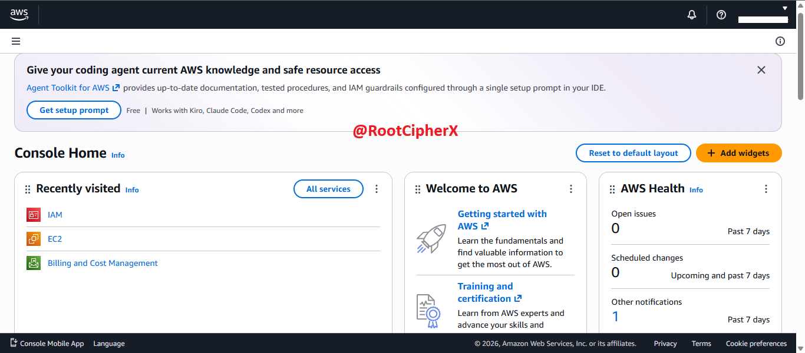

Accessed the unified search bar and queried for **IAM** to open the Identity and Access Management service[cite: 122].
<br>

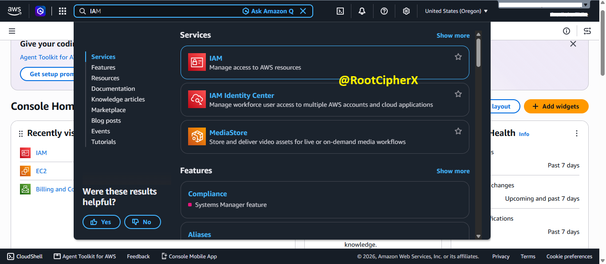

Opened the **IAM Dashboard** and verified initial environment metrics: **0** active security recommendations, green checkmark for root MFA, and an initial baseline of **0 User groups** and **0 Users**[cite: 123].
<br>

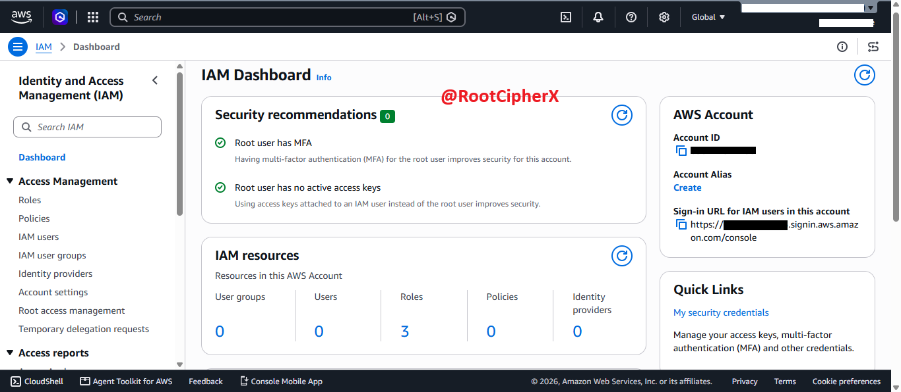

---

### Phase 2: Administrative User Group Provisioning & Policy Attachment

In accordance with AWS best practices, permissions should be assigned to groups rather than directly to individual users. Selected **Access Management -> IAM user groups** in the left navigation pane and clicked **Create group**[cite: 124].
<br>

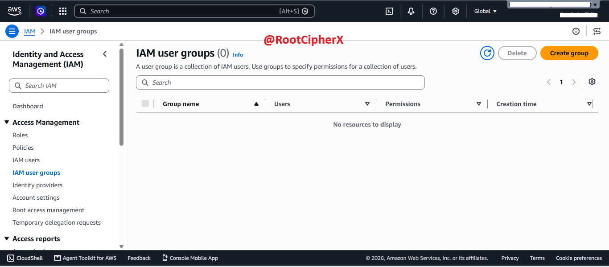

Initiated the group provisioning modal and entered `Admin` into the **User group name** input field[cite: 125, 130].
<br>

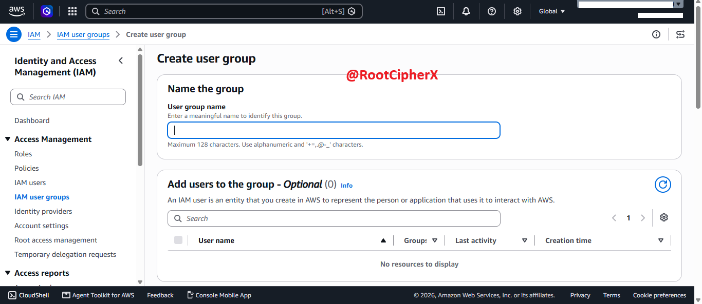

Scrolled down to the **Attach permissions policies** catalog (displaying 1,223 AWS-managed policies) to locate administrative access controls[cite: 126].
<br>

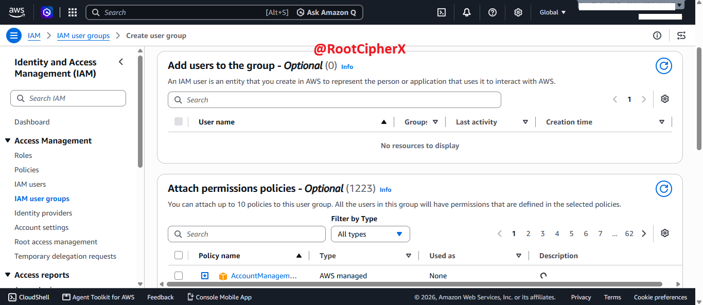

Filtered through the policy list to locate administrative permissions[cite: 127].
<br>

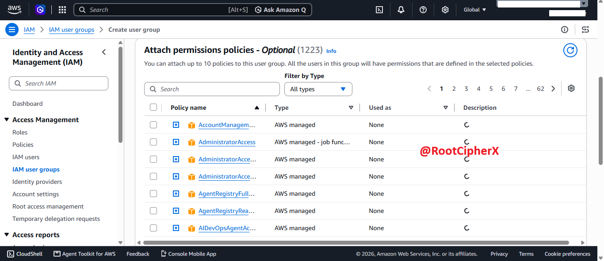

Selected the primary AWS-managed job function policy: **`AdministratorAccess`**[cite: 118]. This policy provides full access to AWS services and resources across the account[cite: 118].
<br>

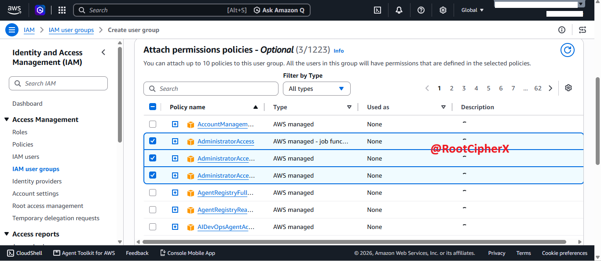

Committed the group creation by clicking **Create user group**[cite: 129].
<br>

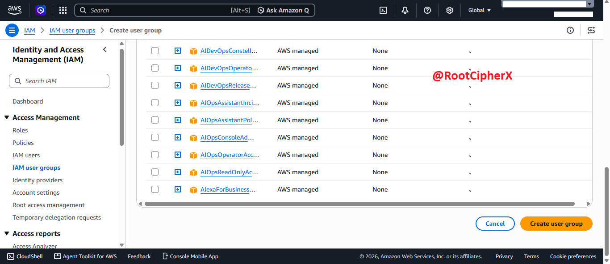

The console returned a confirmation banner (*"Admin user group created."*), confirming the `Admin` group was instantiated with permissions defined[cite: 130].
<br>

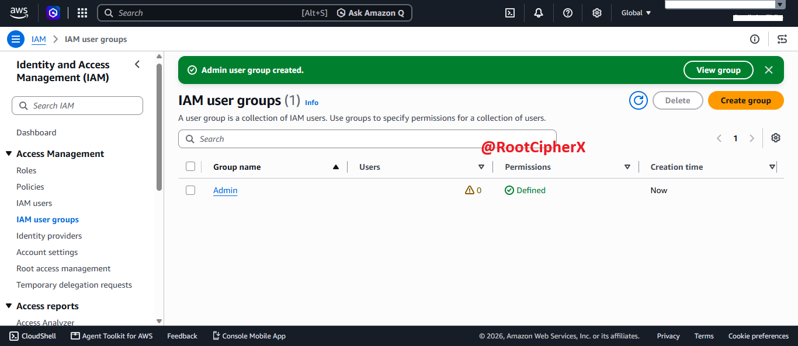

---

### Phase 3: Delegated Administrator Account Provisioning

With the permissions container established, navigated to **Access Management -> IAM users** and clicked **Create user** to provision the delegated administrator[cite: 131].
<br>

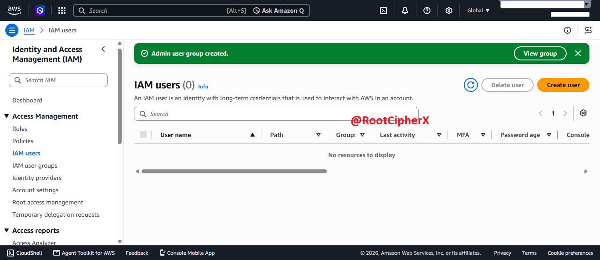

Entered Step 1 (*Specify user details*)[cite: 132]:
* **User name:** Defined the account identifier as `admin`[cite: 132].
* **Console Access:** Enabled **Provide user access to the AWS Management Console**[cite: 132].
* **Credential Type:** Selected **Autogenerated password** to ensure cryptographic entropy[cite: 132].
<br>

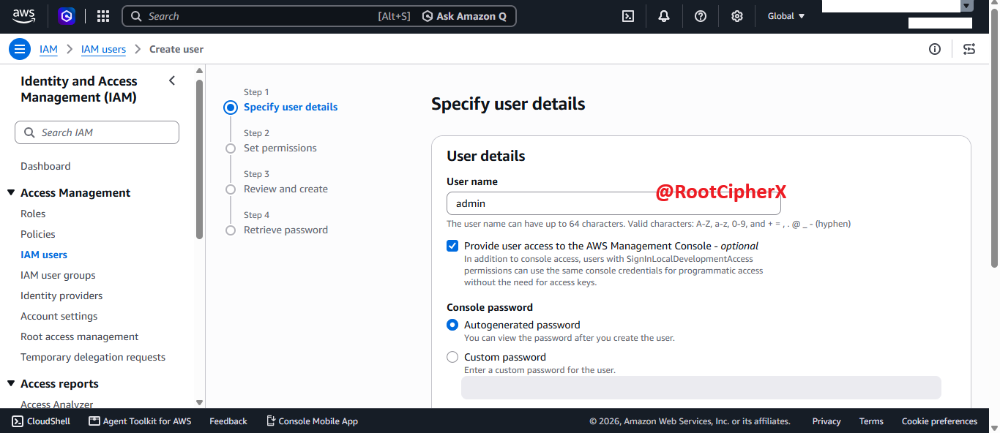

Enforced identity hygiene by checking **Users must create a new password at next sign-in (Recommended)**, which automatically couples the `IAMUserChangePassword` policy to the user[cite: 133]. Clicked **Next**[cite: 133].
<br>

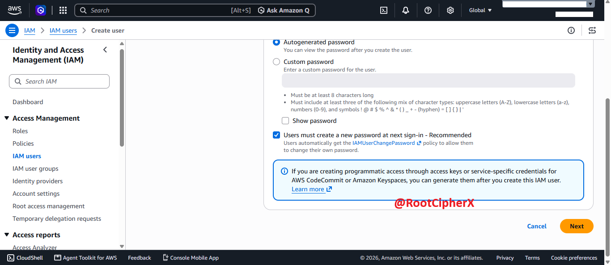

---

### Phase 4: Group Membership Assignment & Creation Audit

In Step 2 (*Set permissions*), opted for **Add user to group** to implement group-based access inheritance[cite: 134].
<br>

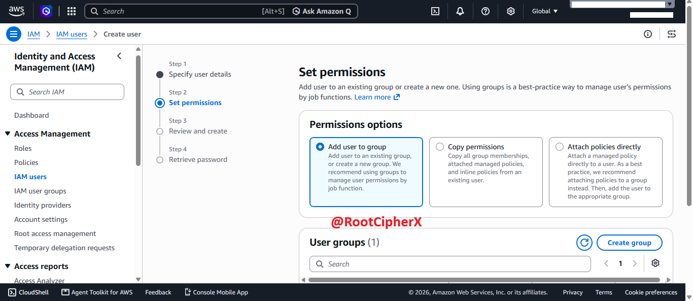

Selected the checkbox for the newly created **Admin** user group[cite: 135]. Through this association, the user inherits the `AdministratorAccess` policy without requiring inline user policies[cite: 135]. Clicked **Next**[cite: 135].
<br>

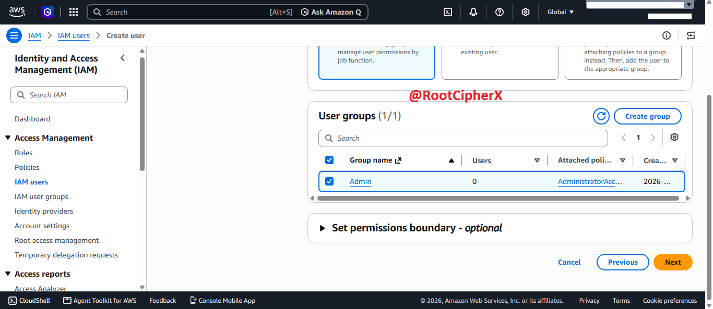

Audited Step 3 (*Review and create*)[cite: 136]:
* **User details:** User name `admin`, autogenerated password, forced password reset enabled[cite: 136].
* **Permissions summary:** Group membership set to `Admin` with attached policy `IAMUserChangePassword`[cite: 136].
<br>

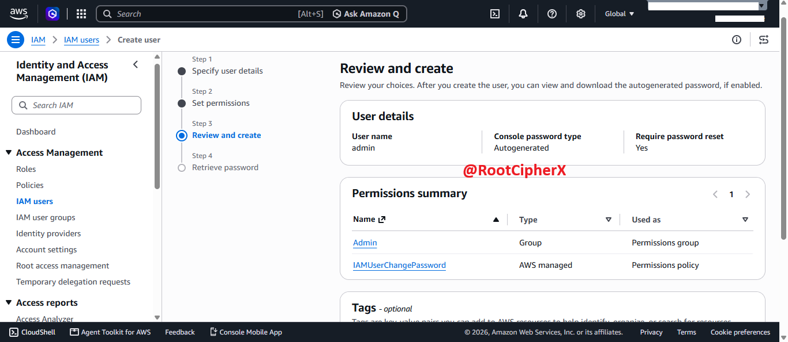

Bypassed optional tag creation and clicked **Create user** to finalize account provisioning[cite: 137].
<br>

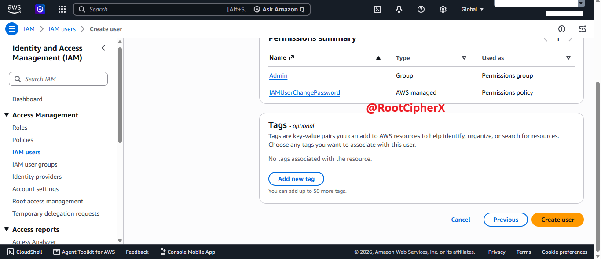

Received the **User created successfully** confirmation banner[cite: 128].
<br>

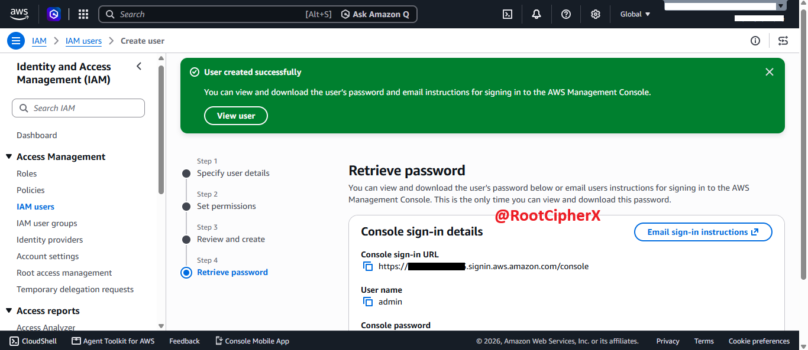

In Step 4 (*Retrieve password*), captured the critical account onboarding artifacts[cite: 139]:
* **Console sign-in URL:** Account-specific sign-in endpoint containing the AWS Account ID[cite: 139].
* **Credentials:** Username `admin` and the temporary autogenerated console password[cite: 139].
* Clicked **Return to users list** and executed a full logout from the root account[cite: 139].
<br>

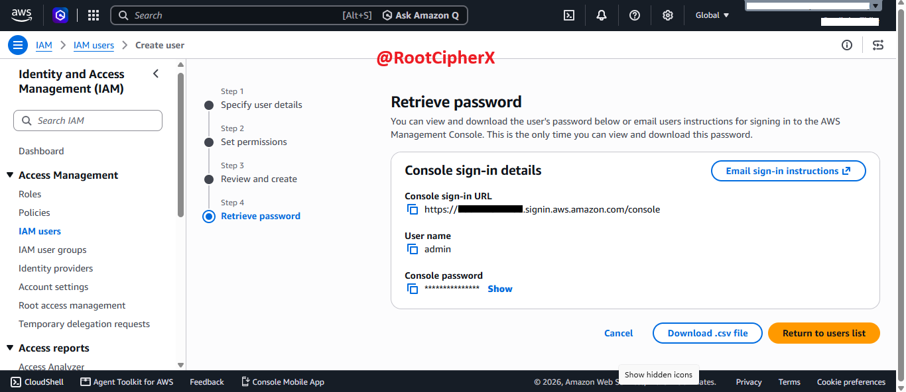

---

### Phase 5: First-Time Login & Enforced Password Rotation

Navigated to the dedicated account sign-in URL[cite: 139, 140]. The **IAM user sign in** portal automatically populated the 12-digit Account ID[cite: 140]. Entered `admin` and the temporary autogenerated password, then clicked **Sign in**[cite: 140].
<br>


The console immediately enforced the password rotation boundary with a **Password reset** screen[cite: 141]. Entered the temporary password into the **Old Password** field and supplied a strong, compliant master secret into the **New Password** fields[cite: 141]. Clicked **Confirm Password Change**[cite: 141].
<br>

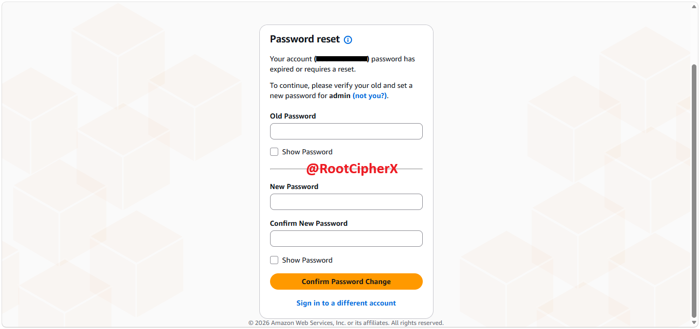

The console confirmed the update with a **Password reset successful** confirmation banner[cite: 142]. Clicked **Continue to sign in**[cite: 142].
<br>

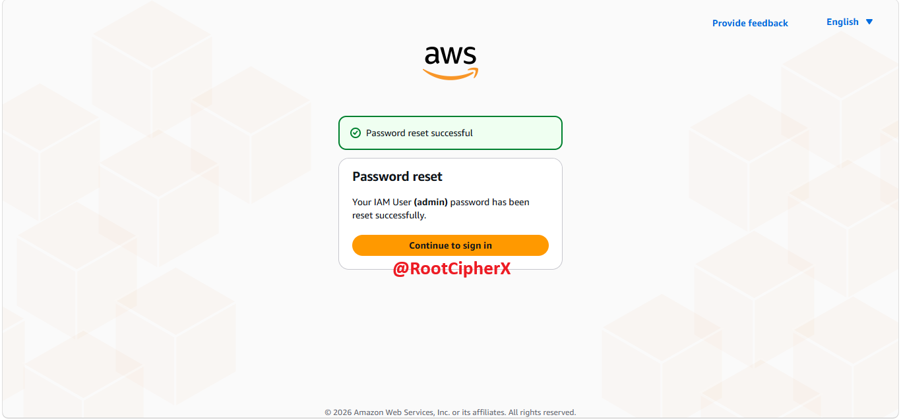

Re-authenticated through the IAM user portal using the newly established administrative password[cite: 143].
<br>


Successfully authenticated into **Console Home** as `admin`, confirmed by the user identity badge in the global navigation bar[cite: 144].
<br>

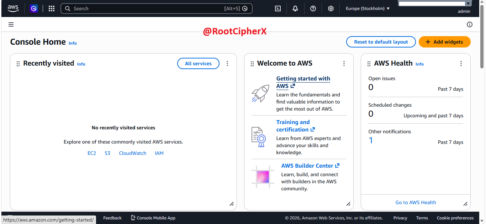

---

### Phase 6: Delegated Admin Session Verification & MFA Provisioning

To complete the defense-in-depth posture, the delegated administrator account must be protected by its own independent secondary authentication factor. Searched for **IAM** within the delegated administrative console[cite: 145].
<br>

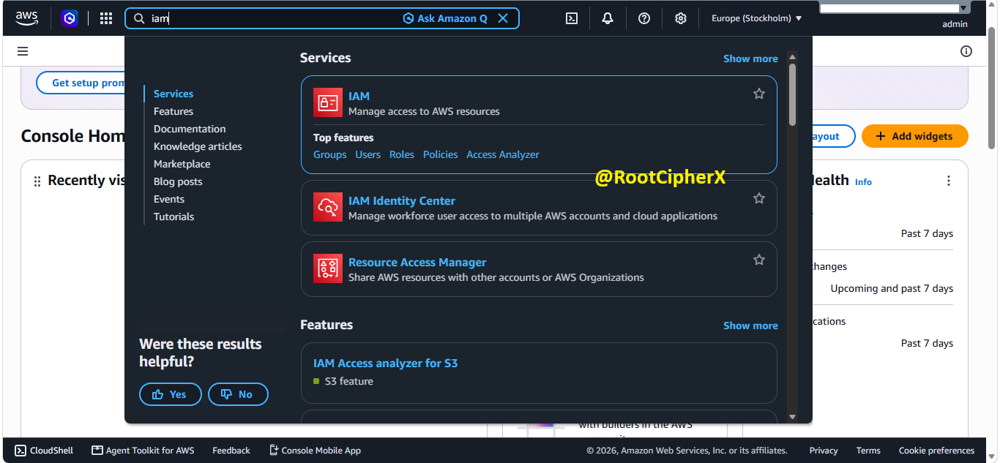

The IAM Dashboard flagged a new operational recommendation[cite: 146]:
* **Recommendation:** *"Add MFA for yourself - Add multi-factor authentication (MFA) for yourself to improve security for this account."*[cite: 146]
* Clicked **Add MFA** to launch the device assignment workflow[cite: 146].
<br>

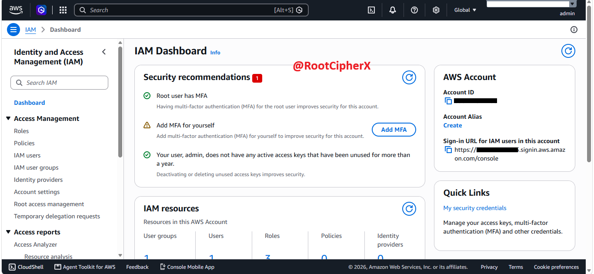

Entered the **Assign MFA device** wizard and defined the unique identifier string in the **MFA device name** field[cite: 147].
<br>

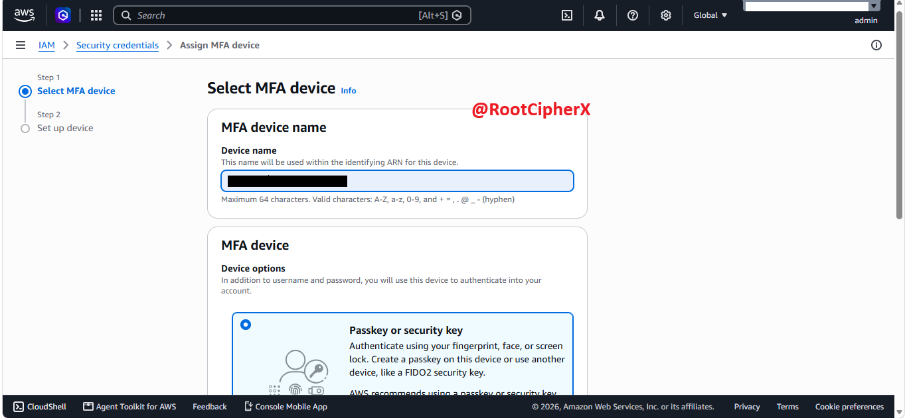

Selected the **Authenticator app** radio option and clicked **Next**[cite: 138].
<br>

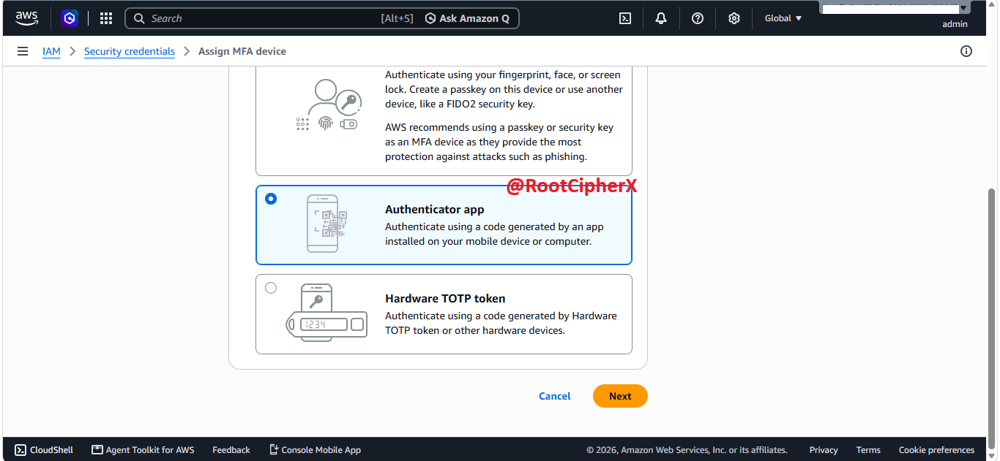

Reached Step 2 (*Set up device*) and selected **Show QR code** to reveal the secret seed[cite: 149].
<br>


Scanned the QR code using Google Authenticator on the mobile device[cite: 149]. Captured and entered two consecutive TOTP codes (`590384` and `855445`) generated 30 seconds apart, then clicked **Add MFA**[cite: 150].
<br>


Received confirmation via the green notification banner: *"MFA device assigned"*[cite: 151]. The security credentials table now reflected an active Virtual MFA device assigned to user `admin`[cite: 151].
<br>

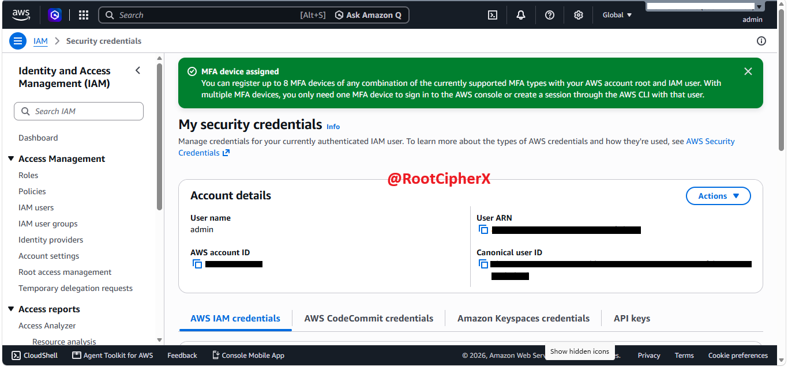

---

### Phase 7: End-to-End Delegated MFA Authentication Verification

To validate that two-factor enforcement was strictly gating delegated access, opened the global user menu and clicked **Sign out**[cite: 152].
<br>


Navigated back to the account-specific sign-in URL and entered the `admin` username and password[cite: 140, 143]. 

Upon credential validation, AWS intercepted the session with the mandatory secondary challenge: **Additional verification required**[cite: 153]. Retrieved the active 6-digit TOTP code (`441889`) from Google Authenticator, input the value, and clicked **Sign in**[cite: 153].
<br>


The console accepted the cryptographic proof and authorized access to **Console Home**, confirming end-to-end delegated administrative security[cite: 148].
<br>


---

## Cloud Security Relevance & Architectural Impact

Implementing delegated administration with group-level policies and enforced MFA achieves critical security milestones:

* **Elimination of Root Exposure (CIS Control 1.7):** Daily administrative tasks are fully decoupled from the root account, allowing the root credentials to be locked in a secure vault and reserved exclusively for account-level emergency recovery.
* **Privilege Delegation via Groups (Least Privilege):** Rather than attaching inline policies to individual users, attaching `AdministratorAccess` to the `Admin` group enforces clean role-based access control (RBAC)[cite: 118, 134]. If an administrator departs, revoking group membership instantly terminates administrative rights.
* **Credential Lifecycle Hygiene:** Requiring initial password changes prevents administrator accounts from operating with static, known, or emailed onboarding passwords[cite: 133, 141].
* **Two-Factor Assurance Across All Administrative Tiers:** Enforcing virtual TOTP MFA on both the root identity and delegated administrators ensures that compromised credentials alone cannot grant console access at any privilege tier[cite: 120, 153].

---

## Ethical Guidelines & Disclaimer
This lab was conducted within an authorized, privately owned Amazon Web Services account strictly for defensive engineering, cloud identity assurance, and compliance validation. All account IDs, aliases, and sensitive cryptographic seeds have been redacted to ensure tenant security while demonstrating standard operational procedures.
